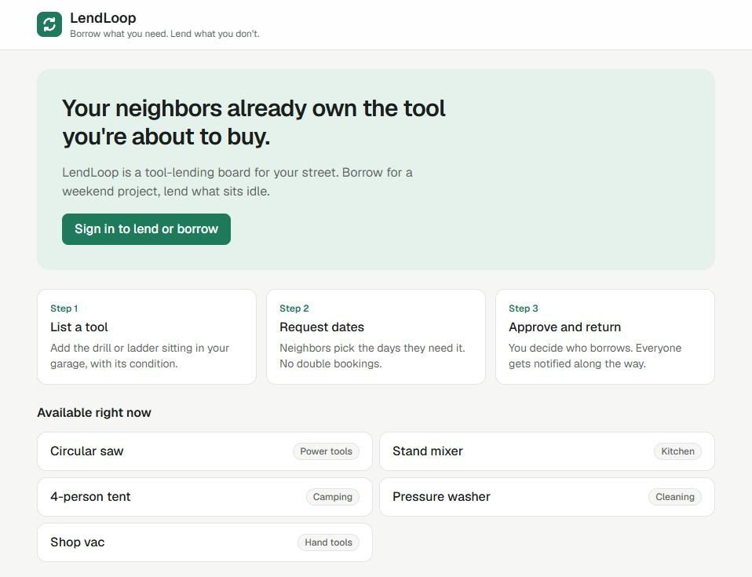
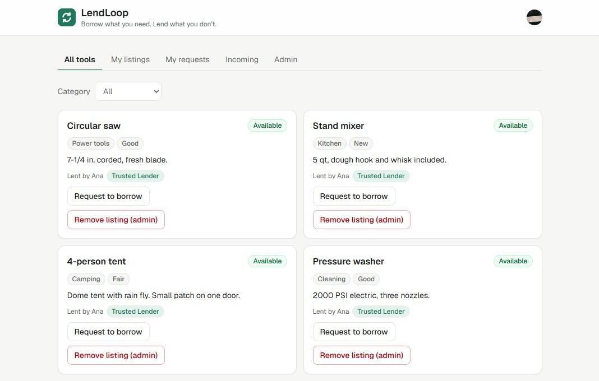
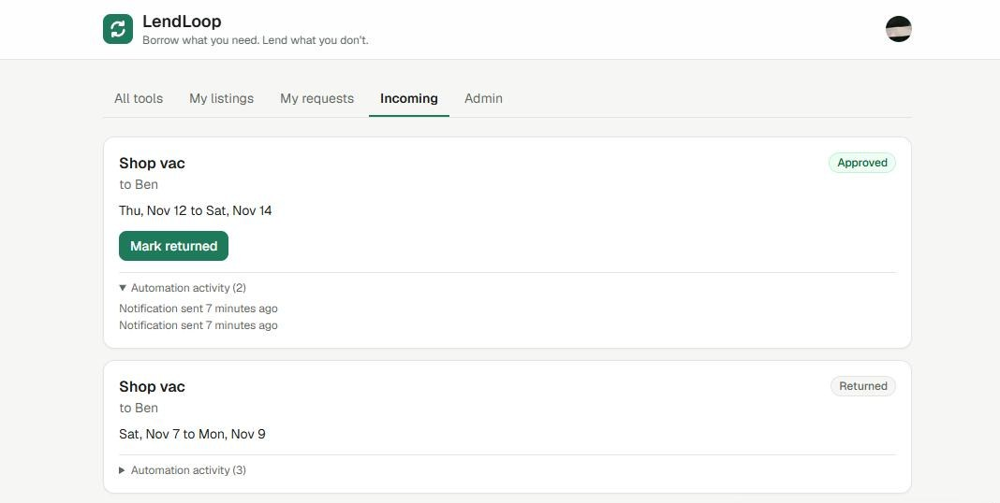
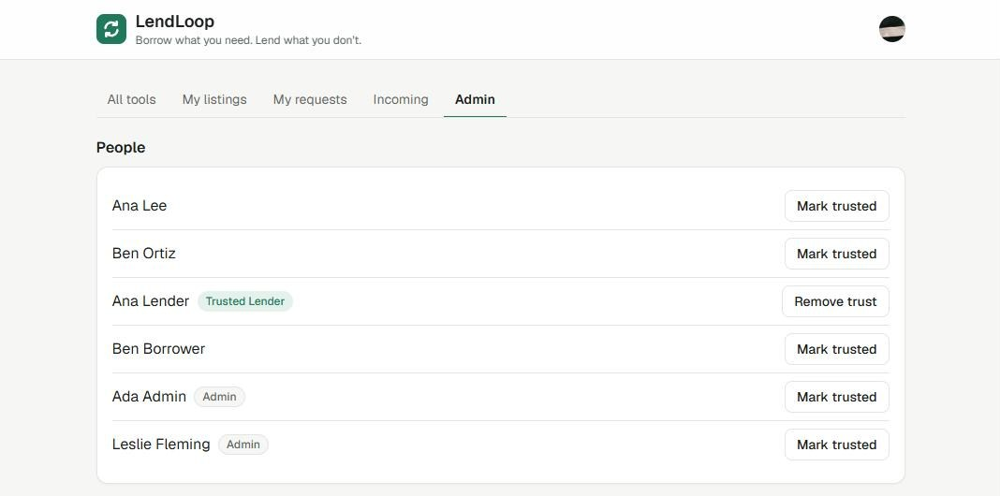

# LendLoop

**Borrow what you need. Lend what you don't.**

A neighborhood tool-lending board. Neighbors list tools, others request them for a date
range, owners approve or decline and mark them returned. n8n handles the notifications and
a daily overdue reminder.

Stack: Next.js 15 (App Router, TypeScript), Clerk (auth), Convex (data + backend rules),
n8n (self-hosted in Docker).

| Signed out | Browse (signed in, admin) |
|---|---|
|  |  |
| **Incoming requests** | **Admin** |
|  |  |

Built with [Claude Code](https://claude.com/claude-code) as a pair programmer.

## What it does

**Signed out:** the public page lists tools that are available today, showing name and
category only (no owner, no description, no ids), plus a "Sign in to lend or borrow" button
(Clerk).

**Signed in:**

| Tab | What you can do |
|---|---|
| All tools | Every tool with availability, filter by category, request a date range |
| My listings | Create, edit, remove your own tools |
| My requests | Your borrow requests and their status, with automation activity per loan |
| Incoming requests | Approve / decline requests on your tools, mark a loan returned |
| Admin (admins only) | All users (mark Trusted Lender), all loans; "Remove listing" on any tool card |

Request rules (enforced in `convex/loans.ts`): no borrowing your own tool, no past start
dates, max 30 days, no overlap with an approved loan, one pending request per tool per
borrower. Removing a tool that is lent out is refused; open requests on a removed tool are
declined.

## Architecture

```
Browser (Next.js client views)
   |  Clerk session -> "convex" JWT template
   v
Convex  (queries / mutations; every access check lives here)
   |  loan status change -> automationEvents row (pending) -> scheduled action
   |  POST signed JSON ------------------------------------>  n8n workflow 1
   |                                                          verify HMAC, dedupe, notify
   |  <-- signed POST /n8n/overdue-loans ----------------------  n8n workflow 2 (daily)
   |  <-- signed POST /n8n/reminder-status (per loan) ---------  remind, write back
   v
automationEvents (shown per loan in the UI)
```

| Path | Role |
|---|---|
| `app/page.tsx`, `components/` | Single page with tabs. Every view is a live Convex query, so there are no protected routes to get wrong. One `LoanList` serves My requests, Incoming and Admin. |
| `convex/schema.ts` | `users`, `tools`, `loans`, `automationEvents` |
| `convex/lib/auth.ts` | `requireUser` / `requireAdmin`. Identity comes from the verified Clerk JWT (`ctx.auth`), never from arguments. |
| `convex/tools.ts`, `loans.ts`, `admin.ts`, `users.ts` | Public API with ownership and role checks |
| `convex/notify.ts` | Signed outbound delivery to n8n, retry with backoff (5 attempts, then `failed`) |
| `convex/http.ts`, `automation.ts` | The two endpoints n8n calls, HMAC-verified, idempotent write-back |
| `convex/lib/hmac.ts` | Sign / verify (Web Crypto, constant-time compare) |
| `n8n/` | docker-compose, the 3 exported workflows, their Code-node sources and tests. See [`n8n/README.md`](n8n/README.md). |

**Roles.** `user`: CRUD on own listings, acts only on requests involving their own tools or
their own borrowing. `admin`: remove any listing, view all loans, mark a lender "Trusted
Lender". Admin is granted on sign-in to emails in the `ADMIN_EMAILS` Convex env var. The UI
hides buttons for convenience only; each Convex function re-checks.

## Setup

Requires Node 20+ (developed on 24) and Docker.

```bash
npm install
```

**1. Clerk.** Create a Clerk application. In **JWT Templates** add the **Convex** template and
keep its name `convex` (the app requests that template). Note its **Issuer** URL.

**2. Convex.** Start the dev backend (prompts for login, or use a local anonymous backend):

```bash
npx convex dev            # or: CONVEX_AGENT_MODE=anonymous npx convex dev
npx convex env set CLERK_JWT_ISSUER_DOMAIN https://<your-clerk-issuer>
npx convex env set ADMIN_EMAILS you@example.com
```

`npx convex dev` writes `CONVEX_DEPLOYMENT` and `NEXT_PUBLIC_CONVEX_URL` to `.env.local`.

**3. Next.js.** Add the Clerk keys to `.env.local` and run:

```bash
npx next dev              # http://localhost:3000
```

**4. n8n.**

```bash
cp n8n/.env.example n8n/.env                     # set N8N_SIGNING_SECRET
npx convex env set N8N_SIGNING_SECRET <same value>
npx convex env set N8N_LOAN_EVENT_WEBHOOK_URL http://localhost:5678/webhook/lendloop-loan-event
npm run n8n:up                                   # docker compose, n8n on http://localhost:5678
npm run n8n:import                               # import + activate the 3 workflows
```

**Tests:** `npm test` (Vitest: Convex functions via `convex-test`, formatting helpers, and the
exported n8n Code nodes run against Convex's own sign/verify).

### Environment variables

| Name | Where | Purpose |
|---|---|---|
| `NEXT_PUBLIC_CONVEX_URL`, `CONVEX_DEPLOYMENT` | `.env.local` (written by `convex dev`) | Convex client |
| `NEXT_PUBLIC_CLERK_PUBLISHABLE_KEY`, `CLERK_SECRET_KEY` | `.env.local` | Clerk |
| `CLERK_JWT_ISSUER_DOMAIN` | Convex env | Issuer of the Clerk `convex` JWT template |
| `ADMIN_EMAILS` | Convex env | Comma-separated emails granted admin on sign-in |
| `N8N_LOAN_EVENT_WEBHOOK_URL` | Convex env | Workflow 1 webhook URL |
| `N8N_SIGNING_SECRET` | Convex env **and** `n8n/.env` | Shared HMAC secret, both directions |
| `LENDLOOP_CONVEX_SITE_URL` | `n8n/.env` (optional) | Convex HTTP actions URL as seen from n8n; defaults to the host's dev backend |

`.env*` files are gitignored (except the `.env.example` files). Nothing secret is in the repo
or in the exported workflow JSON.

## Security

- **Authorization in Convex, not the UI.** Every query and mutation resolves the viewer from
  the verified Clerk token and checks ownership or role before reading or writing. Tests in
  `convex/lendloop.test.ts` cover the refusals (signed-out callers, editing or removing someone
  else's listing, deciding someone else's request, borrowing your own tool, admin-only
  functions). The owner check was confirmed to fail its test when deliberately removed.
- **Signed in both directions.** Convex signs every webhook; n8n verifies before acting. n8n
  signs every call to Convex; `convex/http.ts` returns 401 and touches nothing on a bad or
  missing signature. Signature = hex HMAC-SHA256 over `<unix seconds>.<raw body>`, 300 s
  replay window, constant-time compare. n8n verifies the raw request bytes, not re-serialized
  JSON.
- **Idempotent automation.** Each loan transition gets one `automationEvents` row keyed
  `loan:<id>:<status>`, so it can queue only one notification. n8n drops redelivered event ids.
  Reminder write-backs are keyed `reminder:<loanId>:<day>`: a retry updates the same row, and
  a late "failed" never overwrites "sent".
- **Failures are visible.** Convex retries delivery with backoff and records `failed` after 5
  attempts; n8n's Convex calls retry 3 times and then fire the error workflow. Every loan shows
  its automation history in the UI.
- **Input limits.** Names 80 chars, descriptions 500, ISO dates validated, loans at most 30 days.

## Data minimization

- The public list returns tool name and category only.
- Loan views show first names only; emails are never sent to the browser for other users.
- n8n receives only what one message needs: recipient first name and email, tool name, dates.
  The overdue endpoint returns the same fields per overdue loan, nothing else.
- The Clerk JWT template carries only `aud`, `name`, `email`.
- n8n prunes execution history after 7 days; its port binds to localhost only.

## Production note

To run this for real:

1. **Convex:** `npx convex deploy` to a production deployment; set the same env vars there
   with a fresh `N8N_SIGNING_SECRET` (never reuse the dev one).
2. **Clerk:** a production instance on your domain, its own `convex` JWT template, and
   `CLERK_JWT_ISSUER_DOMAIN` pointed at it.
3. **Next.js:** deploy (e.g. Vercel) with the production Clerk keys and Convex URL.
4. **n8n:** run the compose file behind a TLS reverse proxy, set `N8N_HOST`,
   `WEBHOOK_URL` and `N8N_PROTOCOL=https`, create the owner account with a strong password, and back up the
   `n8n/data` volume (or move to Postgres). Point `LENDLOOP_CONVEX_SITE_URL` at
   `https://<deployment>.convex.site`.
5. **Real notifications:** replace the two logged-mock Code nodes with Send Email / Slack
   nodes. The payloads already contain what they need; route send failures to the error
   workflow, and for reminders write back `status: "failed"`.
6. **Secrets:** n8n reads the HMAC secret from its container env (`$env`), which anyone who
   can edit workflows can read. With more than one n8n editor, move it into an n8n credential.
   Rotate the secret by setting the new value in Convex and n8n together; there is no
   dual-secret window yet.
7. **Known limits:** availability uses UTC dates; the public list scans up to 200 tools
   (add pagination at scale); the n8n dedupe memory lives in workflow static data, which is
   per instance.
